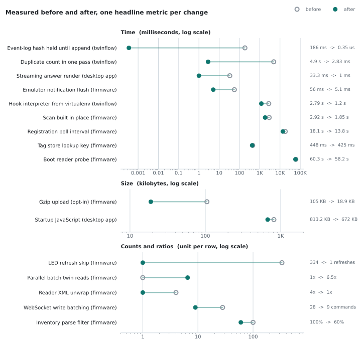
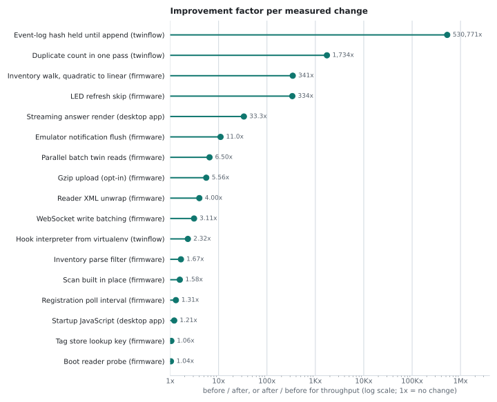
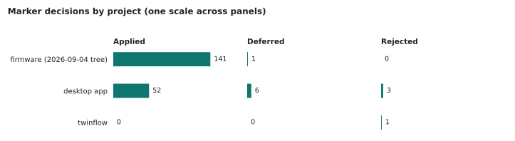

# Performance Ladder Review

A [Claude Code](https://docs.claude.com/en/docs/claude-code) skill that makes the agent review and
write code like a performance engineer who measures first. It refuses speed claims without a
number, deletes work before tuning it, climbs a fixed ladder of fixes from configuration down to
micro-optimization, and leaves a `PERF:` comment wherever a decision needs to survive the next
reader. Simplifying and speeding up are treated as one job.

## Why

**No claim without a number.** Model-written "optimizations" are often neutral, slower, or broken,
and a single timing run can't tell the difference. The skill asks for a measurement that names the
hotspot before any hand-tuning, a before and an after, medians instead of single runs, and a real
significance test. When a change can't be measured, it is marked `estimated` and says why.

**Delete before you tune.** The fastest code is the code that never runs. Removing a layer, a
copy or a round trip beats making it faster, and it leaves fewer places for bugs.

**Climb the ladder in order.** Each rung is cheaper and safer than the one below it:

| Rung | Move | Examples |
| ------ | ------ | ---------- |
| L0 | Configuration before code | release build flags, compression, connection reuse, pool sizes |
| L1 | Don't do the work | delete dead code, cache pure work, early exit, dedupe calls |
| L2 | Do it less often | batch, debounce, lazy-load, paginate |
| L3 | Fix the complexity class | nested scan to hash lookup, query in a loop to one JOIN, N+1 to eager load |
| L4 | Let the platform do it | push filtering into the database, vectorize, use the stdlib |
| L5 | Move it off the critical path | async, queues, background jobs, streaming |
| L6 | Micro-optimize the measured hotspot | only with a profile, only while it stays readable |

The full rules, including the safety floor (correctness, validation and auth are never traded for
speed) and the guardrails on what the agent may change without sign-off, are in
[`skills/performance-ladder-review/SKILL.md`](skills/performance-ladder-review/SKILL.md).

## The `PERF:` marker

`PERF:` is an existing comment keyword, highlighted by editors next to `TODO:` and `FIX:`
(todo-comments.nvim ships it by default; VS Code's Todo Tree highlights it once `PERF` is added to
`todo-tree.general.tags`). Every decision the skill makes in code reads as one of these:

```text
PERF: <rung> - <what changed>, <before> -> <after> (<method>)      applied, measured
PERF: <rung> - <what changed> (estimated; <why it can't be measured>)  applied, estimated
PERF: deferred - <open question>, <revisit trigger>                deferred to a maintainer
PERF: <rung> rejected - <why no change is needed>                  investigated, no change
```

```c
// PERF: L3 - query-in-loop -> JOIN, 1.2s -> 45ms (median of 10)
// PERF: L1 - memoized parse (estimated; pure fn called per render; unmeasurable here)
// PERF: deferred - O(n^2) merge fine at n<1k, revisit past 10k rows
// PERF: L3 rejected - nested scan stays under 1k elements per the documented fleet size
```

The marker line is the only place a before and after belongs. The prose around it describes the
current code, never the edit.

## Commands

Inside a session the skill recognizes these mode names:

| Command | What it does |
| --------- | -------------- |
| `/perf-mode full` | ladder and simplification on all code touched (default); `review`, `hotspot`, `off` switch modes |
| `/perf-review` | findings only: location -> cost -> fix, ranked by estimated cost with a confidence tag |
| `/perf-loop` | measure, fix one thing, re-measure, keep only significant wins; never edits tests |
| `/perf-harvest` | lists every `deferred` and `estimated` marker with its revisit trigger |
| `/perf-help` | quick reference |

Claude Code registers the skill itself as `/performance-ladder-review`, and loads it on its own
when a conversation is about speed, slowness or simplification. The short names above are modes
the skill reads from your request, so pass them as text: `/performance-ladder-review perf-review src/`,
or "run a perf-review on the upload path".

## Install

Copy or link `skills/performance-ladder-review` into your personal skills directory, or into a
project's `.claude/skills/` to share it with everyone on that repository.

```sh
# personal, macOS or Linux
git clone https://github.com/ragonxdragon/performance-ladder-review.git
ln -s "$PWD/performance-ladder-review/skills/performance-ladder-review" ~/.claude/skills/performance-ladder-review

# one project
mkdir -p .claude/skills
cp -r performance-ladder-review/skills/performance-ladder-review .claude/skills/
```

```powershell
# personal, Windows
Copy-Item -Recurse performance-ladder-review\skills\performance-ladder-review "$HOME\.claude\skills\"
```

Start a new Claude Code session and run `/performance-ladder-review perf-help` to check it loaded.

## Results in real projects

The skill has run since 2026-07-21 on three of my projects: a cellular IoT gateway
firmware (ESP32, client work, private), a desktop AI model manager (private),
and [twinflow](https://github.com/ragonxdragon/twinflow) (Python, public). Every number below was
written at the time of the change, in a commit message or in the `PERF:` comment on the changed
code. Nothing was re-run or estimated for this page.

<picture>
  <source media="(prefers-color-scheme: dark)" srcset="results/charts/before-after-dark.svg">
  
</picture>

<picture>
  <source media="(prefers-color-scheme: dark)" srcset="results/charts/reduction-factor-dark.svg">
  
</picture>

The strongest measured results:

| Project | Change | Before | After | Method |
| --------- | -------- | -------- | ------- | -------- |
| twinflow | [Count repeated sequence numbers in one pass (L3)](https://github.com/ragonxdragon/twinflow/commit/03df49a3540ab08307d3c2377030043f35a6b76c) | 4,903 ms | 2.827 ms | n=16,000, identical output at every size |
| twinflow | [Hold the event-log hash until an append changes it (L1)](https://github.com/ragonxdragon/twinflow/commit/03df49a3540ab08307d3c2377030043f35a6b76c) | 185.77 ms | 0.00035 ms | 8,000 events, repeat lookups |
| twinflow | [Resolve the hook interpreter once (L0)](https://github.com/ragonxdragon/twinflow/commit/3a3a28ee2ccccde51a855b728346dbbd2323cdab) | 2,787 ms | 1,202 ms | pre-commit wall clock, three runs each |
| desktop app | Reparse only the unfinished block of a streaming answer (L1) | 33.3 ms | 1.0 ms | per frame at 16 KB, release build |
| firmware | Walk the parsed inventory once instead of indexing per tag (L3) | 341x | 1x | relative time at 4,000 tags, host benchmark |
| firmware | Skip the LED refresh when the pixel color is unchanged (L1) | 334 | 1 | refreshes per 10 s in the steady state, host bench |
| firmware | Flush emulator notifications without an idle sleep | 56.0 ms | 5.1 ms | median of 100 queued notifications |
| firmware | Batch WebSocket writes (L2) | 28 | 9 | modem send commands per full refresh, on device |
| firmware | Build the upload scan in place (L1) | 2.92 s | 1.85 s | 1,000 tags, on device, median of 10 cycles |
| firmware | Poll device registration every 0.5 s | 18.1 s | 13.8 s | randomized 2x2 factorial, Mann-Whitney p=0.0020 |
| firmware | Read device twins in parallel during batch provisioning (L5) | 1x | 6.5x | throughput vs serial at 8 workers (11.7x at 16) |

The registration row is the measurement protocol doing its job: a single before and after timing earlier
the same day had picked the slower 3 s interval, and the factorial showed that comparison was
noise.

Five more firmware changes were measured going to zero, which a log axis can't show: allocations
for 500 tags re-read 200 times (100,000 to 0, host bench), heap allocations to build a 1,000-tag
scan (2,000 to 0), internal heap held by a per-antenna map at 500 tags (20 KB to 0), bytes copied
per config callback (3.2 KB to 0), and CI cache restore time per job (17-19 s to 0).

<picture>
  <source media="(prefers-color-scheme: dark)" srcset="results/charts/marker-verdicts-dark.svg">
  
</picture>

| Project | Perf commits | Measured changes | Estimated changes | Perf commits with no number |
| --------- | -------------: | -----------------: | ------------------: | ----------------------------: |
| firmware | 63 | 18 | 29 | 21 |
| desktop app | 41 | 2 | 3 | 36 |
| twinflow | 2 | 3 | 0 | 0 |

Measured points are few outside the firmware: 23 measured changes in all, 17 of them charted.
The full dataset is [`results/results.csv`](results/results.csv) (83 rows) with per-project counts
in [`results/summary.csv`](results/summary.csv).

### How the data was gathered, and its limits

- **Selection.** Commits since 2026-07-21 whose conventional-commit type is `perf`, or that named
  the skill, plus fix commits merged as part of a review pass, across all branches of the three
  repositories. This is my own work after adopting the skill, chosen by commit type. It is
  not a controlled study, and there is no comparison against what the same work would have
  produced without the skill.
- **Numbers as stated.** Every value comes from a commit message, from the `PERF:` comment on the
  changed code, or from the project's own release documentation, found by searching every revision
  of each repository. Retained Claude Code session logs were searched too; they only go back to
  mid-September and confirmed figures already in the commits. Methods vary and
  are recorded in the `method` column: on-device bench medians, host benchmarks, build output,
  single-checkout measurements. A row is `measured` only when the commit says it was measured;
  computed, simulated, approximate and by-construction figures are `estimated` and never appear in
  a chart. Where a commit message and its code comment disagree, the CSV keeps the commit message
  and notes the other figure.
- **Noise.** Two charted firmware results (1.04x and 1.06x) are medians without a stated
  significance test and sit below the 1.1x to 1.2x noise floor the skill itself uses, so treat them
  as unproven.
- **Context for single rows.** The 530,771x twinflow figure compares recomputing a hash against
  reading a held value, so it applies to repeat calls. The gzip upload result is opt-in and off by
  default. The parallel twin-read figure is throughput, so higher is better; the factor chart
  inverts it to match the others. The startup JavaScript cut is deterministic, but the same commit found no launch-time
  change above run-to-run noise.
- **Charts** show one headline metric per change, the first row for that change in the CSV.
- **Markers.** Counts come from `git grep` over each project's main branch, excluding vendored and
  dependency directories and docs, and include an earlier marker spelling used before the projects
  settled on `PERF:`. The firmware later moved decision records from code comments into commit
  messages, so its counts come from the last tree that carried markers (2026-09-04).
- **Privacy.** Two of the projects are private. Their commits are not linked, client-identifying
  details are removed, and the desktop app appears only as a metric and a one-line description.

Regenerate the charts with:

```sh
uv run --no-project --with matplotlib python results/make_charts.py
```

## Independent A/B pilot

A controlled pilot on [SWE-fficiency](https://github.com/swefficiency/swefficiency), a public
benchmark of performance work in real Python repositories. Each task gives the agent a repository
and a slow workload; the official harness checks that the repository's tests still pass and times
the workload against the expert patch.

**Setup (all rounds, 2026-10-14 and 2026-10-15):**

- Tasks come from a 40-task sample drawn with a fixed seed from the 411 instances that a
  reliability audit ([arXiv 2607.01211](https://arxiv.org/abs/2607.01211)) found stable across
  machines.
- Two arms, one run each per task. Same model (`claude-sonnet-5-5`), Claude Code CLI 2.1.238,
  official SWE-fficiency prompt, and instance container in both. The skill arm differs only in
  having `skills/performance-ladder-review/` installed.
- Caps: 100 turns and 60 minutes per run. Each run used a fresh config directory with only the
  credentials file and, for the skill arm, the skill. It had no CLAUDE.md, hooks, plugins, MCP
  servers, or other skills (the CLI's bundled skills were switched off in both arms).
- Scoring: the official SWE-fficiency harness, run after the agent runs finished, on the same four
  pinned CPU threads, on a laptop (i9-11900H, WSL2, 15 GB).

"Speedup" is the workload speedup the harness measured for the agent's patch. "vs expert" is the
benchmark's score: that speedup divided by the expert patch's speedup, counted as no speedup when
the official correctness check fails. Above 1 beats the expert. Tokens are the CLI's totals for
the run (input / cache write / cache read).

### Round 1: original skill

Tasks: `sympy__sympy-12640` and `astropy__astropy-6941`, the two smallest images in the sample.

| Task | Arm | Tests pass | Speedup | Expert speedup | vs expert | Output tokens | Other tokens | Turns | Wall time | Skill fired | Profiled before first edit |
| --- | --- | --- | ---: | ---: | ---: | ---: | --- | ---: | ---: | --- | --- |
| sympy-12640 | baseline | yes | 5.27x | 1.79x | 2.94 | 2,648 | 18 / 55,037 / 321,591 | 9 | 92 s | no | yes |
| sympy-12640 | skill | yes | 3.76x | 1.79x | 2.09 | 3,714 | 20 / 40,643 / 443,276 | 12 | 130 s | yes | yes |
| astropy-6941 | baseline | yes | 9.10x | 26.28x | 0.35 | 7,124 | 26 / 45,031 / 612,271 | 15 | 102 s | no | yes |
| astropy-6941 | skill | yes | 1.94x | 26.28x | 0.07 | 3,869 | 20 / 42,349 / 455,564 | 11 | 122 s | yes | yes |

The baseline scored higher on both tasks. On sympy both arms wrote nearly the same patch, and the
gap is inside this laptop's timing noise: the unmodified code measured 0.011 s to 0.034 s across
scoring runs. Astropy shows a real difference in behavior. After the same first fix in both arms,
the skill arm sorted its profile by self time, wrote "The profile is now flat, with no remaining
single dominant cost", and stopped "rather than chase small gains". The profile still had 22
percent of the time in frame construction, the work the baseline and the expert patch removed.

**What I changed in the skill.** A measured win is now a checkpoint: re-profile by inclusive
time, keep going while one call tree on the measured path holds about 20 percent or more of the
time, prefer skipping repeated work or changing the algorithm there, and stop only on a named
condition. When a task supplies a benchmark workload, that workload is the profile target and its
inputs set n. Details and the full diagnosis are in
[`benchmark/README.md`](benchmark/README.md#diagnosis-and-skill-revision).

### Round 2: revised skill, new tasks

Tasks: `numpy__numpy-19608` and `pydata__xarray-9808`, the two smallest remaining images from
repositories round 1 did not use. I tuned the revision on the round 1 tasks, so round 2 tests it
on tasks it was not fitted to.

| Task | Arm | Tests pass (official) | Speedup | Expert speedup | vs expert | Output tokens | Other tokens | Turns | Wall time (CLI time) | Skill fired | Profiled before first edit |
| --- | --- | --- | ---: | ---: | ---: | ---: | --- | ---: | ---: | --- | --- |
| numpy-19608 | baseline | no (2 tests, also failing for the expert here) | 1.63x | 1.00x | 0.996 | 7,392 | 24 / 39,216 / 529,624 | 12 | 177 s (176 s) | no | no (timed only) |
| numpy-19608 | skill | no (1 test, also failing for the expert here) | 1.58x | 1.00x | 0.996 | 18,494 | 38 / 106,787 / 1,065,171 | 22 | 570 s (567 s) | yes | yes |
| xarray-9808 | baseline | not scorable | n/a | n/a | n/a | 21,143 | 112 / 101,288 / 3,570,944 | 57 | 3,635 s (3,402 s) | no | yes |
| xarray-9808 | skill | not scorable | n/a | n/a | n/a | 33,038 | 80 / 113,416 / 3,352,086 | 46 | 4,261 s (1,864 s) | yes | yes |

Round 2 shows the revised behavior but gives no usable score comparison:

- **xarray** cannot be scored on this machine. Its workload opens a public cloud Zarr store, and
  the scorer's run of the unmodified workload ran out of memory every time, including in the
  expert patch's scoring run. With no expert timing, neither arm has a score.
- **numpy** fails the official correctness check in both arms. The failing tests also fail under
  the expert patch on this machine, and the expert's own speedup does not reproduce here (1.00x),
  so both arms score 0.996. The raw speedups are not comparable either: the laptop slept and ran on
  battery during scoring, and the unmodified code measured 1.14 s, 7.11 s and 2.12 s across the
  three scoring runs.
- **Behavior:** the revised skill kept working after its first win in both tasks: on numpy it made
  a second round of changes after re-profiling (22 turns against 12), and on xarray it fixed three
  hotspots against the baseline's two.
- **The 4,261-second run** did not break the 60-minute cap in running time. The laptop was in
  standby or asleep for about 2,390 s of it, and the cap counted running time only. The runner now
  also enforces the cap on wall time, waits for AC power, holds a keep-awake request (working from
  round 3 on), and rescores any timing run that spans a pause.

### Round 3: revised skill, new tasks, two runs per arm

Tasks: `sympy__sympy-20384` and `astropy__astropy-7924`, the two smallest unused images. Before any
agent time, the runner scored the expert patch on each and accepted the task only if it timed,
showed at least 1.2x, and passed every required test on this machine. Both passed (expert speedups
72.68x and 8.82x), so no replacement was needed. All runs here pass the official correctness
check, and no scoring run spanned a pause or battery power.

| Task | Arm | Run | Speedup | Expert speedup | vs expert | Output tokens | Other tokens | Turns | Wall time | Skill fired | Profiled before first edit |
| --- | --- | ---: | ---: | ---: | ---: | ---: | --- | ---: | ---: | --- | --- |
| sympy-20384 | baseline | 1 | 107.27x | 72.68x | 1.48 | 2,218 | 8 / 27,693 / 124,435 | 5 | 122 s | no | yes |
| sympy-20384 | baseline | 2 | 129.95x | 72.68x | 1.79 | 1,451 | 10 / 12,738 / 176,934 | 5 | 69 s | no | yes |
| sympy-20384 | skill | 1 | 448.51x | 72.68x | 6.17 | 7,656 | 42 / 60,689 / 1,262,033 | 23 | 214 s | yes | yes |
| sympy-20384 | skill | 2 | 139.25x | 72.68x | 1.92 | 2,497 | 12 / 23,134 / 249,750 | 8 | 128 s | yes | yes |
| astropy-7924 | baseline | 1 | 4.61x | 8.82x | 0.52 | 2,253 | 14 / 27,492 / 245,325 | 7 | 141 s | no | yes |
| astropy-7924 | baseline | 2 | 5.10x | 8.82x | 0.58 | 2,023 | 14 / 13,764 / 257,667 | 7 | 96 s | no | yes |
| astropy-7924 | skill | 1 | 6.01x | 8.82x | 0.68 | 5,937 | 46 / 90,329 / 1,127,439 | 25 | 131 s | yes | yes |
| astropy-7924 | skill | 2 | 3.55x | 8.82x | 0.40 | 3,569 | 16 / 28,104 / 349,384 | 10 | 124 s | yes | yes |

Averaged over its two runs, the skill arm scored higher on sympy-20384 (3.44 against 1.62 times
the expert) and about the same on astropy-7924 (0.52 against 0.55). Every run on a task found the
same first fix. The sympy gap comes from one skill run that re-profiled after that fix, found
`PolyElement.str` holding about 97 percent of the remaining time, and fixed it too; the other
skill run stopped after the first fix. The revised skill also cost more: 16.5 turns against 6 and
4,915 output tokens against 1,986 per run on average.

### Across all rounds

| Round | Skill | Task | Runs per arm | Baseline vs expert | Skill vs expert | Result |
| --- | --- | --- | ---: | ---: | ---: | --- |
| 1 | original | sympy-12640 | 1 | 2.94 | 2.09 | baseline higher |
| 1 | original | astropy-6941 | 1 | 0.35 | 0.07 | baseline higher |
| 2 | revised | numpy-19608 | 1 | 0.996 | 0.996 | no usable score |
| 2 | revised | xarray-9808 | 1 | not scorable | not scorable | no usable score |
| 3 | revised | sympy-20384 | 2 | 1.62 | 3.44 | skill higher |
| 3 | revised | astropy-7924 | 2 | 0.55 | 0.52 | about the same |

The original skill scored lower on both of its scored tasks. The revised skill scored higher on one
and about the same on the other. In three of its four round 3 runs it re-profiled after the first
fix and then either fixed the next hotspot or stopped on a stated inclusive-time share. In round 1
both original-skill runs stopped after their first fix.

### Caveats

Six tasks ran; four produced official scores, two for each skill version, with one or two runs per
arm. That cannot establish a difference in either direction, and I make no significance claim. The
spread between two runs of the same arm on one task (1.92 to 6.17 for the skill on sympy-20384) is
as large as any gap between arms. The skill was revised after seeing round 1, and rounds 2 and 3
use new tasks to avoid fitting it to the tasks it was revised on. Laptop timing is far noisier
than the benchmark's reference cloud machines. The pilot shows the method works end to end and
found a concrete flaw in the original skill. It can be reproduced or extended with
[`benchmark/run.py`](benchmark/run.py); the method, fairness controls, the host problems, and the
deviations from the official setup are in [`benchmark/README.md`](benchmark/README.md). Full
outputs, including every patch, are in [`benchmark/results/`](benchmark/results/).

## Repository layout

| Path | Contents |
| ------ | ---------- |
| `skills/performance-ladder-review/` | the skill: `SKILL.md` and `references/` |
| `results/results.csv` | one row per measured or estimated metric |
| `results/summary.csv` | per-project commit and marker counts |
| `results/make_charts.py` | renders the light and dark SVGs in `results/charts/` |
| `benchmark/` | the SWE-fficiency A/B harness, its task list, and the pilot results |

## License

[MIT](LICENSE), copyright (c) 2026 John Hall.
